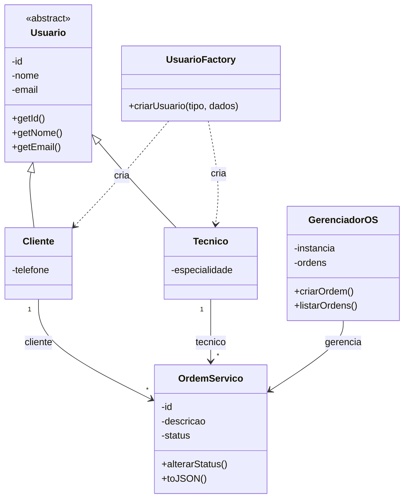

# TechOS Core

## 1. Descrição do projeto

O TechOS Core é um sistema de gerenciamento de ordens de serviço para uma assistência técnica. Ele permite representar clientes, técnicos e ordens de serviço, aplicando conceitos de Programação Orientada a Objetos e padrões de projeto.

## 2. Histórias de usuário

### História 1 — Cadastro de usuários

**Como** operador da assistência técnica,  
**quero** criar clientes e técnicos com seus dados,  
**para** organizar as informações dos envolvidos nas ordens de serviço.

**Critérios de aceitação:**
- O sistema deve permitir criar usuários do tipo Cliente e Técnico.
- O Cliente deve possuir nome, e-mail e telefone.
- O Técnico deve possuir nome, e-mail e especialidade.
- O sistema deve rejeitar dados obrigatórios vazios ou inválidos.

### História 2 — Gerenciamento de ordens de serviço

**Como** operador da assistência técnica,  
**quero** registrar e consultar ordens de serviço,  
**para** acompanhar os serviços solicitados e seus responsáveis.

**Critérios de aceitação:**
- Cada ordem deve possuir um cliente, um técnico e uma descrição.
- O sistema deve gerar um identificador para cada ordem.
- Uma ordem deve iniciar com o status ABERTA.
- O sistema deve permitir listar as ordens cadastradas.
- O sistema deve aceitar apenas os status previstos na implementação.

## 3. Requisitos não funcionais

### RNF01 — Validação e segurança

O sistema deve validar os dados recebidos e rejeitar informações obrigatórias vazias ou inválidas. Caso futuramente seja integrado a uma aplicação web, deverá também tratar as entradas e saídas adequadamente para reduzir riscos de ataques, como XSS.

### RNF02 — Desempenho

As operações principais, como criar e listar ordens de serviço, devem responder em menos de 2 segundos em condições normais de uso. Esse objetivo deverá ser confirmado por testes de desempenho.

## 4. Modelagem orientada a objetos

O projeto utiliza uma classe base chamada `Usuario`, da qual herdam as classes `Cliente` e `Tecnico`. A classe `OrdemServico` representa os serviços cadastrados.

### Diagrama de classes



## 5. Padrões de projeto

- **Factory:** a classe `UsuarioFactory` centraliza a criação de clientes e técnicos conforme o tipo informado.
- **Singleton:** a classe `GerenciadorOS` mantém uma única instância do gerenciador de ordens de serviço.

## 6. Conceitos de POO

- **Abstração:** a classe `Usuario` representa características comuns dos usuários.
- **Herança:** `Cliente` e `Tecnico` herdam de `Usuario`.
- **Encapsulamento:** os dados e comportamentos são organizados nas classes.
- **Polimorfismo:** os diferentes tipos de usuário podem ser criados por meio de uma interface comum da fábrica.

## 7. Tecnologias utilizadas

- JavaScript
- Node.js
- Módulos ES
- Git e GitHub
- Visual Studio Code

## 8. Como executar

1. Instale o Node.js.
2. Abra o terminal na pasta do projeto.
3. Execute:

```bash
npm start
```

O sistema demonstrará a criação de um cliente, de um técnico e de uma ordem de serviço, além de exibir a lista de ordens.

## 9. Observação

Os requisitos não funcionais descrevem objetivos do projeto. O cumprimento do tempo de resposta e das medidas adicionais de segurança deve ser verificado por testes apropriados.
